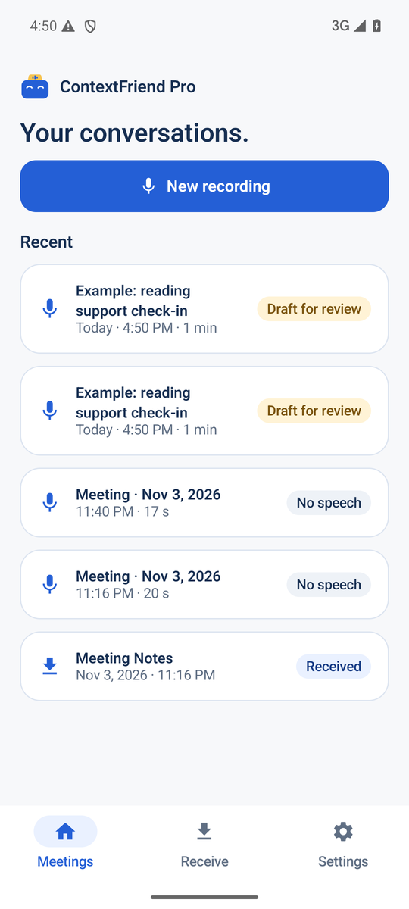
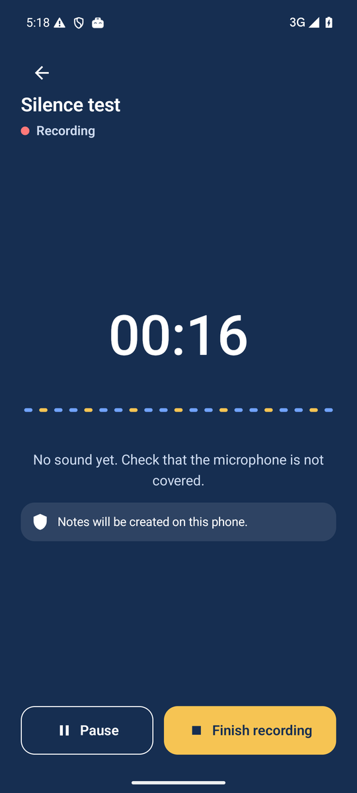
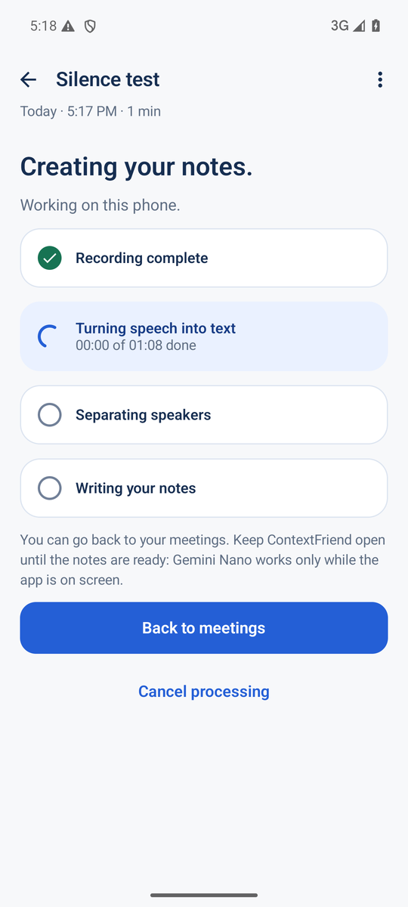
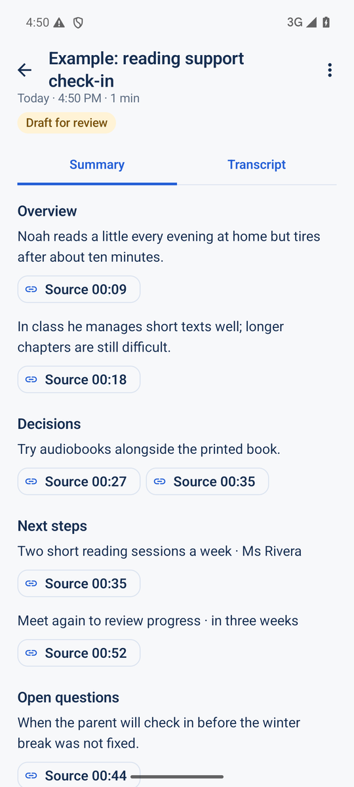
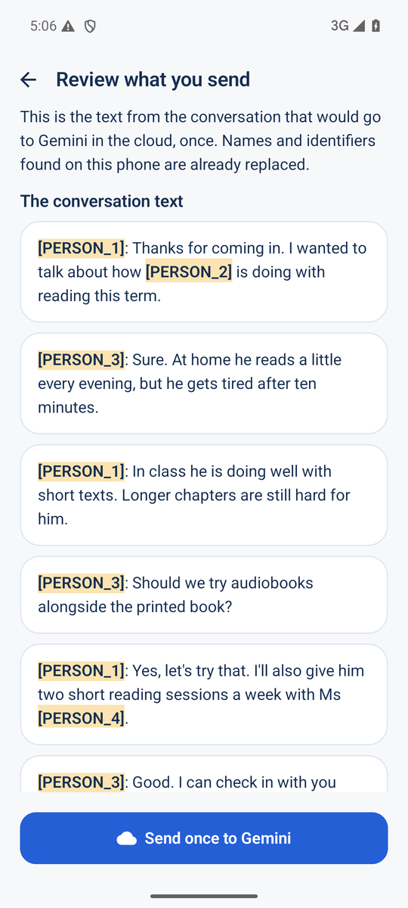
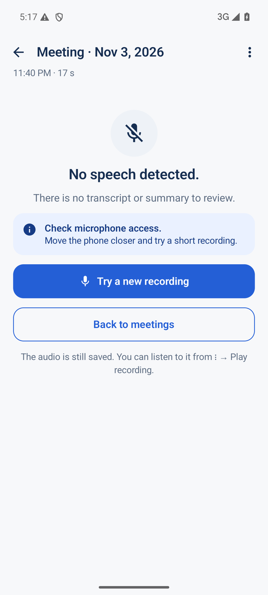

# ContextFriend Pro Hybrid

**Meeting notes for teachers, where the conversation never has to leave the phone.**

ContextFriend Pro records a school meeting (a parent–teacher conference, a support-plan meeting, a
counselling conversation), transcribes it, tells the speakers apart and writes sourced notes,
all on the phone. The notes come from **Gemini Nano through Firebase AI Logic** with
`ONLY_ON_DEVICE`, or from our own Gemma 4 engine for German and Hebrew. The cloud is used only when
the teacher asks for it: names are replaced on the phone first, the teacher sees the exact text that
would be sent, and the answer is put back together on the phone.

> **#BuildHybridAI 2026 entry.** Try it: **[landing page](https://tamerintech.github.io/context-friend-pro-hybrid/)** · **[APK](https://github.com/TamerinTECH/context-friend-pro-hybrid/releases/latest)**
> (Android 12+, free, no account). The native recorder in the first commit is disclosed pre-existing
> work ([docs/PRE_EXISTING.md](docs/PRE_EXISTING.md)); everything after it was built during the
> submission period ([CHANGELOG.md](CHANGELOG.md)). Phone checks on a Pixel 11 Pro are reported in
> [docs/TEST_REPORT.md](docs/TEST_REPORT.md); what is left before the submission is in
> [docs/NEXT_STEPS.md](docs/NEXT_STEPS.md).

## Screens

Emulator, debug build, synthetic example meeting (25 Nov 2026). Status: [docs/DONE.md](docs/DONE.md),
[docs/PENDING.md](docs/PENDING.md).

| Meetings | Recording | Creating notes |
|---|---|---|
|  |  |  |
| **Summary** | **Review what you send** | **No speech** |
|  |  |  |

## Why hybrid here means a privacy boundary

German teachers cannot paste conversations about children into cloud chatbots: school
data-protection rules and the GDPR forbid it. So most don't use AI for this at all.
ContextFriend Pro uses hybrid inference the other way round from most apps: **the device is the
default, and the step to the cloud is deliberate, inspected and consented.**

| Step | Where it runs | Engine |
|---|---|---|
| Record, store | Phone, encrypted vault | Android audio, AES-GCM with Android Keystore |
| Transcribe | Phone | whisper.cpp (ContextFriend engine) |
| Tell speakers apart | Phone | sherpa-onnx: pyannote segmentation + TitaNet-S |
| Meeting notes (English) | Phone | **Gemini Nano 4 via Firebase AI Logic, `ONLY_ON_DEVICE`** |
| Meeting notes (German, Hebrew; phones without Nano) | Phone | Gemma 4 E2B via llama.cpp (ContextFriend engine) |
| Better notes, if the teacher asks | Cloud, EU | **Gemini via Firebase AI Logic, `ONLY_IN_CLOUD`**, Vertex AI `eu`, placeholders only, with consent |
| Share | Phone to phone, or cloud link | QR / Bluetooth / LAN with libsodium; Firestore stores ciphertext only |

Diagram and rules: [docs/HYBRID_ARCHITECTURE.md](docs/HYBRID_ARCHITECTURE.md).

## How Firebase AI Logic is used

All in [`Hybrid.kt`](android/app/src/main/java/tech/tamerin/contextfriendpro/Hybrid.kt):

- `FirebaseAI.getInstance(app, GenerativeBackend.agentPlatform("eu"))` with two models built per task:
  `OnDeviceConfig(mode = InferenceMode.ONLY_ON_DEVICE, modelOption = OnDeviceModelOption.PREVIEW)` for
  meeting notes, and `OnDeviceConfig(mode = InferenceMode.ONLY_IN_CLOUD)` for the opt-in redacted
  request. No `PREFER_*` mode ever sees meeting content, because it falls back to the cloud silently.
- `onDeviceExtension.checkStatus()` / `download()` drive the Gemini Nano card and its download button.
- `response.inferenceSource` is checked on every answer (`Policy.verifySource`); a mismatch is
  discarded and logged as a policy violation. The badge on each summary shows the recorded source.
- Gemini Nano's 4,000-token request limit: long meetings are map-reduced with source ids carried
  through ([`Notes.kt`](android/app/src/main/java/tech/tamerin/contextfriendpro/Notes.kt)).
- **App Check** (debug provider in debug builds, Play Integrity in release), **anonymous
  Authentication**, **Remote Config** (cloud model, Nano option, chunk size, extra protected terms, a
  kill switch for local-only mode) and **Cloud Firestore** (end-to-end-encrypted links,
  [rules](firebase/firestore.rules)).

## Privacy, in code and tests

- [`Policy.kt`](android/app/src/main/java/tech/tamerin/contextfriendpro/Policy.kt): automatic routing
  never picks the cloud; the cloud gate needs the kill switch on, a complete redaction and consent.
- [`Redaction.kt`](android/app/src/main/java/tech/tamerin/contextfriendpro/Redaction.kt): deterministic
  pseudonymiser (names with genitive and hyphenated forms, honorifics, e-mail, phone, dates, addresses,
  IBAN, links, IDs, school names) and local re-identification.
- [`CloudDraft.kt`](android/app/src/main/java/tech/tamerin/contextfriendpro/CloudDraft.kt): the exact
  outgoing prompt is built and shown on the phone; the mapping lives in memory for one request.
- [`Audit.kt`](android/app/src/main/java/tech/tamerin/contextfriendpro/Audit.kt): a privacy log with
  metadata only, exportable as JSON.
- **75 unit tests** on synthetic data run on every push, including proofs that the cloud model is
  never called without consent or with the kill switch on.

Honest limits: Gemini Nano runs only in the foreground and is validated on-device for English; the
redaction can miss a name nobody listed, which is why the panel shows the full text and asks every
time; this is not a legal certification of anonymity, and the app makes no medical or legal judgements.

## Try it

- [Testing instructions](docs/TESTING.md) (devices, Gemini Nano 4 setup, a five-minute tour)
- [Fictional demo meeting script](docs/demo/parent-teacher-conference.md)
- [Landing page](https://tamerintech.github.io/context-friend-pro-hybrid/) with install steps and the local AI guide
- APK: [latest release](https://github.com/TamerinTECH/context-friend-pro-hybrid/releases/latest) (signed; checksums on the release page)

## Build

```bash
python tools/bootstrap.py          # pinned native sources and the sherpa-onnx archive
cd android && ./gradlew :app:assembleDebug :app:testDebugUnitTest
```

Firebase is optional for a build: without options in `android/local.properties` the app runs
fully offline with the ContextFriend engine. To connect your own Firebase project, follow
[docs/FIREBASE_SETUP.md](docs/FIREBASE_SETUP.md). More: [docs/BUILD.md](docs/BUILD.md).

## Built on

[ContextFriend](https://www.context-friend.com) is TamerinTECH's AI product for schools, local by
design; this edition brings its school-meeting knowledge to phones. Third-party software and models:
[THIRD_PARTY_NOTICES.md](THIRD_PARTY_NOTICES.md).

## Licence

Apache-2.0, see [LICENSE](LICENSE) and [NOTICE](NOTICE). © 2026 TamerinTECH GmbH.
