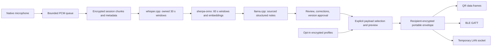

# Architecture

Android owns Kotlin/Compose, AudioRecord, Keystore, camera2, BLE and socket adapters.
Apple owns SwiftUI, AVAudioEngine/Converter, Keychain/CryptoKit, camera, Core Bluetooth
and Network adapters. `native/` shares the actual Whisper/Gemma bridge; Android uses
sherpa's Kotlin binding and Apple its C API. No platform speech/cloud API is used.

The vault stores encrypted records, avoiding plaintext database journals. Each stage
checkpoints completed window counts and model hashes. Pipeline failures preserve
recordings and completed stages. Process restart marks interrupted work for an explicit
retry. Inference is sequential, cancellable and bounded by audio/context windows.
It is not a persistent background worker: resume requires opening the app.

Transcription uses 30-second ownership windows plus 2-second neighboring audio;
only segment midpoints belonging to a window are committed. Timestamp mapping uses
the recording timeline, including explicit pauses/gaps. Diarization uses 60-second
windows and reconciles anonymous speakers through actual embeddings. Provisional
cosine thresholds are 0.65 for anonymous reconciliation and 0.75 for profile suggestions.
Overlapping/ambiguous lines retain uncertainty instead of invented speaker attribution.

Summary generation groups source segments into bounded inputs, maps each group to
sourced notes, then recursively reduces groups of three. Intermediate source IDs map
back to the union of original transcript IDs. Context exhaustion is an explicit error.
No output-token cap silently turns incomplete output into a finished summary. The
Gemma 4 single-user, thinking-disabled chat format comes from the pinned model's
canonical template. Grammar limits JSON structure; source-ID validation and manual
factual review remain separate checks.

Review stores original text and corrections. Edits invalidate the exact approved
revision and preserve up to 20 earlier revisions. The UI supports transcript/speaker
correction, source navigation/playback, summary editing, approval, retention and
explicit external summary export. A summary received from another device is readable
without any AI models. The recipient does not silently regenerate it.

Voice profiles live separately from sessions. Session anonymous embeddings are derived
data; enrolled profiles require explicit consent and a name. Profiles never enter a
meeting payload. A separate transfer copies only chosen compatible profiles and starts
them disabled on the receiving device.

Persistent model bytes are public weights, excluded from backup and checked against
the bundled trusted manifest before use. One-time downloads are explicit; the runtime
does not download missing weights or fall back to hosted inference. Offline file import
offers the same hash check. Per-platform UI shows installation and progress/cancellation.

Wire fields, crypto algorithms, bounds and retry semantics are in `shared/PROTOCOL.md`.
The independent Python vector is consumed by Android's instrumented test and Apple's
XCTest source. Only the Android consumer has executed on a mobile OS in this run.
