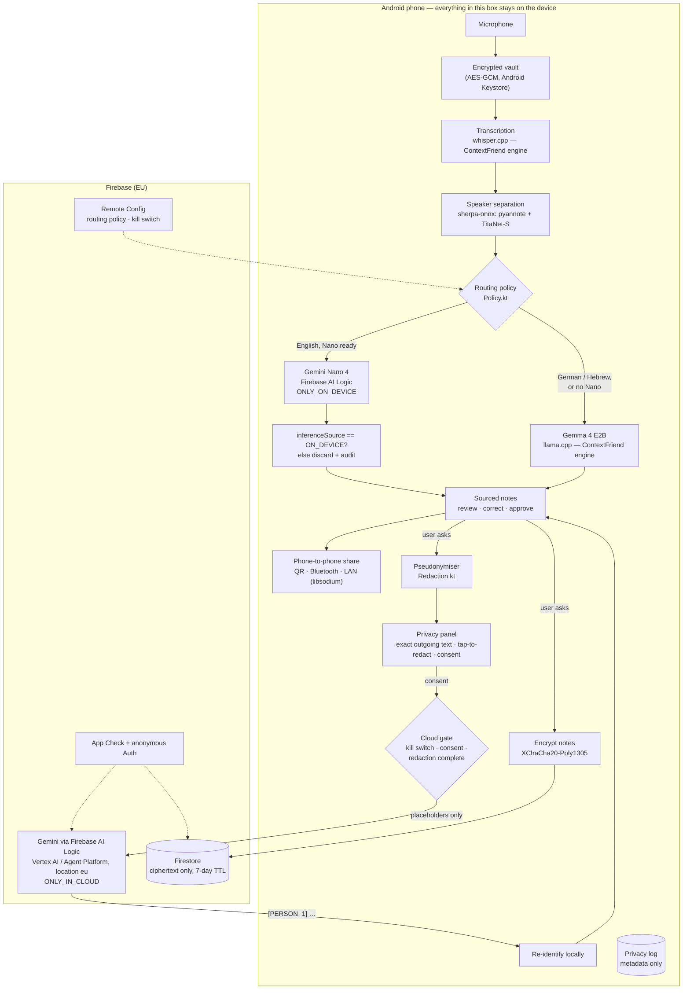

# Hybrid architecture: the privacy boundary

ContextFriend Pro does not use hybrid inference to save money or latency. It uses it as a
**data-protection boundary**: a meeting about a child, a patient or a client is processed on
the phone, and only text the user has reviewed, with names replaced, may go to the cloud.

## Why each piece is where it is

| Piece | Where | Why |
|---|---|---|
| Transcription, speakers | Our engines on the phone | Gemini Nano on Android accepts text and one image, no audio. Speech never leaves the phone. |
| Notes (English) | Gemini Nano via Firebase AI Logic, `ONLY_ON_DEVICE` | On-device by construction. A `PREFER_*` mode falls back to the cloud silently, so meeting content never uses one. |
| Notes (German, Hebrew; phones without Nano) | Gemma 4 E2B via llama.cpp | On-device validation for Gemini Nano covers English and Korean only. German schools need German. |
| Better notes on request | Gemini via Firebase AI Logic, `ONLY_IN_CLOUD`, location `eu` | Long context and quality, but only for pseudonymised text the user reviewed. The EU multi-region keeps data residency and ML processing in the EU. |
| Cloud links | Firestore, ciphertext only | "Hybrid if desired": the server cannot read what it stores; the key is in the link. |
| Routing values | Remote Config | Model names, Nano option, chunk size and a kill switch change without a release. Consent cannot be turned off remotely. |

## The rules in code

1. **Meeting content is sensitive by definition** (`Policy.chooseOnDevice` never returns the cloud).
2. **On-device means `InferenceMode.ONLY_ON_DEVICE`** (`Hybrid.onDeviceModel`), and every answer is
   checked with `Policy.verifySource`; an answer that came from the cloud is discarded and logged as a
   policy violation.
3. **The cloud is a separate user action.** `CloudDraft.build` prepares the exact prompt on the
   device; `CloudDraft.send` runs the gate again right before the request. The model receives that
   prompt and nothing else.
4. **The placeholder mapping lives in one `CloudDraft` object** and is dropped after use. It is
   never logged, stored or sent.
5. **The audit log records metadata only**: action, engine, model, inference source, number of
   requests, replaced-entity counts, characters sent, consent, a short hash of the meeting id.
6. **Gemini Nano limits are respected**: the whole request is at most 4,000 tokens, so long meetings
   are map-reduced in chunks (`Notes.write`); the app keeps the screen on while Nano works, because
   on-device inference runs only for the foreground app.

Code: `Policy.kt`, `Redaction.kt`, `Prompts.kt`, `Notes.kt`, `CloudDraft.kt`, `Hybrid.kt`,
`CloudShare.kt`, `Audit.kt`. Tests: `android/app/src/test/`.

## What the redaction does and does not do

It is deterministic and explainable: known names (speakers the user named, voice profiles, the
user's list of names to protect, with genitive, possessive and hyphenated forms), names after
honorifics and cue words ("Frau …", "Mr …", "my son …"), e-mail addresses, phone numbers, dates,
street addresses and postcodes, IBANs, links, long ID numbers and school names.

It can miss an unusual name that nobody listed. That is why the privacy panel shows the full
outgoing text, offers capitalised words that might be names as one-tap redactions (English), and
requires an explicit consent each time. It is a safeguard, not a legal guarantee of anonymity.
